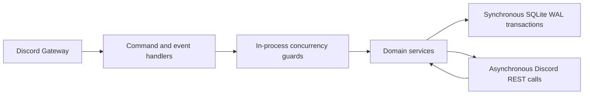

# System architecture

## Runtime and transaction boundaries

One Bun process owns the gateway connection, in-memory coordination and SQLite database. Handlers dispatch interactions to feature services. A transaction commits a reservation or debit before external I/O begins. A second transaction records the observed result. WAL and full synchronous durability protect committed local state across a restart. External calls can succeed even when their response never reaches the process.

## Purchase and ticket recovery

[Migration 0010](../drizzle/0010_correctness_recovery.sql) introduces a purchase journal and a unique pending purchase per user. [Migration 0011](../drizzle/0011_runtime_invariants.sql) replaces obsolete lock tables, normalizes inventory timestamps and constrains balances to nonnegative safe integers.

1. The [purchase service](../src/features/economy/services/purchaseService.ts) commits a conditional debit with the pending journal row. A competing purchase cannot consume the same balance.
2. Role delivery occurs outside SQLite. Inventory insertion and completion commit together. On failure, compensation preserves pre-owned roles and refunds only after confirming that any newly granted role was removed. The refund and terminal journal transition commit together.
3. On gateway readiness and every minute, [purchase recovery](../src/features/economy/events/purchaseRecovery.ts) inspects pending deliveries. A present role completes inventory, an absent role triggers a refund, and a non-role item completes locally. Ambiguous delivery or compensation keeps the purchase pending for retry.

Ticket creation reserves capacity with a creating row before requesting a private channel. The channel topic carries `snoojote-ticket:<record ID>`. On startup and every five minutes, [ticket recovery](../src/features/tickets/events/ticketRecovery.ts) skips active creations and rolls back incomplete ones. It locates the channel by ID or topic, deletes it if present and releases the reservation. A failed lookup or deletion retains the row as `creation_failed`, so a later sweep can retry without exceeding capacity.

## In-process concurrency

[SingleFlight](../src/shared/services/SingleFlight.ts) shares one pending promise among callers refreshing the same resource, including overlapping staff-cache requests. Success and failure both clear the entry so the next refresh can observe new state. [SerialQueue](../src/shared/services/SerialQueue.ts) chains each mutation behind the previous promise for its key. Unrelated keys proceed independently. A rejection reaches its caller while the next operation still runs. The default capacity is 1,000 outstanding operations across keys. Both primitives lose their state on restart, which is why external delivery relies on persisted reservations.

## Forecasting the initial staff response

The [estimator](../src/features/tickets/services/waitTimeEstimator.ts) predicts the first staff response to a newly opened ticket. Model version `per-staff-capacity-v3` combines three measurements.

1. **Historical baseline.** Take the median of up to 20 recent valid response durations. Anchor it to tickets opened on the same weekday in the same four-hour block when that bucket contains at least five valid samples. Otherwise use the global median, falling back to 15 minutes for empty history. Give the recent median weight 0.6 when the latest ticket was created less than 24 hours ago and 0.2 otherwise. With no recent samples, use the anchor directly.
2. **Responder pool.** Weight online, idle and do-not-disturb staff by 1, 0.5 and 0.25 respectively. Multiply by $1 + 0.08\min(c,5)$ for recent participation count $c$. Each active responder contributes their own median if they have at least five valid samples within 90 days. Others contribute the historical baseline. Blend the pool's weighted median into that baseline with weight $0.3$ times the reliable share of total pool weight. An empty pool leaves the historical baseline intact.
3. **Queue pressure.** For unanswered queue length $Q$ and effective staff capacity $S$, compute $L=(\max(Q,0)+1)/\max(S,0.25)$. Divide by median historical load from usable creation snapshots (default 1). Clamp the ratio to $[0.6,3]$, multiply the blended baseline by that ratio, then bound the forecast to one minute through 24 hours.

[Migration 0012](../drizzle/0012_ticket_wait_outcomes.sql) persists the outcome of the initial wait. The [evaluator](../src/features/tickets/services/waitTimeEvaluation.ts) measures forecast error for answered waits with an eligible issued forecast. Cancellation, silent closure and member departure compete with an answer and are counted separately. Still-open waits remain pending. Reopening a ticket cannot turn an earlier cancellation into an answered initial wait.
